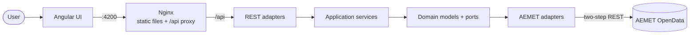

# Technical Weather App

[](https://github.com/dapriad/technical-weather-app/actions/workflows/ci.yml)
[](https://github.com/dapriad/technical-weather-app/actions/workflows/docker-publish.yml)
[](https://github.com/dapriad/technical-weather-app/releases)
[](https://github.com/dapriad/technical-weather-app/releases)

[](https://openjdk.org/projects/jdk/21/)
[](https://spring.io/projects/spring-boot)
[](https://angular.dev/)
[](https://primeng.org/)
[](https://www.docker.com/)
[](https://github.com/dapriad/technical-weather-app/actions)
[](https://opendata.aemet.es/)

A full-stack technical exercise that shows tomorrow's weather for Spanish municipalities using
[AEMET OpenData](https://opendata.aemet.es/). The monorepo contains a Spring Boot API, an Angular
single-page application, Docker images published to GitHub Container Registry, and the CI/CD
pipelines that build and publish them.

[Technical Weather App](docs/assets/weather-app.png)


## What it does

- Search Spanish municipalities with an autocomplete backed by AEMET.
- Show tomorrow's average temperature for the selected municipality.
- Switch between Celsius and Fahrenheit without reloading the page.
- Break down rain probability into `00-06`, `06-12`, `12-18` and `18-24` periods.
- Expose the API through Swagger UI and a generated OpenAPI definition.
- Run the full stack with Docker Compose using multi-architecture container images.

There is no database or authentication in this milestone. The frontend loads the municipality
catalog once in memory and filters it locally; forecast requests still call AEMET on every refresh.

## Technology stack

| Layer | Technology | Version |
|---|---|---|
| Backend | Java | 21 |
| Backend | Spring Boot | 4.1.1 |
| Backend | Springdoc OpenAPI / Swagger UI | 3.1.1 / 5.32.14 |
| Backend | AEMET client | Spring `RestClient` |
| Frontend | Angular | 22.2 |
| Frontend | PrimeNG + Aura theme | 22.1 / 3.0 |
| Frontend | TypeScript | 6.0 |
| Build | Node.js | 24 Alpine |
| Runtime | Nginx | 1.27 Alpine |
| Platform | Docker Compose V2, GitHub Actions, GHCR | current |

## Quick start

You need Docker Engine, Docker Compose V2 and an AEMET OpenData API key. Get a key at
<https://opendata.aemet.es/centrodedescargas/inicio>.

```bash
git clone https://github.com/dapriad/technical-weather-app.git
cd technical-weather-app

cp .env.example .env
# Edit .env and set AEMET_API_KEY to your real key

docker compose up -d
```

Open the application and the API documentation:

```text
http://localhost:4200              # Weather UI
http://localhost:8080/swagger-ui.html
```

Check that the backend is healthy:

```bash
curl -fsS http://localhost:8080/api/health
```

Stop the stack with `docker compose down`. For a reviewer-oriented walkthrough, use the
[onboarding guide](docs/ONBOARDING.md).

## Local development

Install Java 21 and a compatible Node.js version (`22.22.3+`, `24.15.0+` or `26+`), then run the
backend and frontend in separate terminals:

```bash
# Terminal 1 - Spring Boot
cd backend
./mvnw spring-boot:run

# Terminal 2 - Angular dev server
cd frontend
npm ci
npm start
```

The Angular dev server proxies `/api` requests to `http://localhost:8080`.

Run the test suites and the production build:

```bash
cd backend && ./mvnw test
cd frontend && npm test -- --watch=false && npm run build
```

## Architecture at a glance



How a request works:

1. Angular loads the municipality catalog once from `GET /api/municipalities`.
2. The autocomplete filters that catalog locally after three characters. While the catalog is still
   loading, it falls back to a remote search through the same endpoint.
3. Selecting a municipality calls `GET /api/forecast?municipalityId=...&temperatureUnit=...`.
4. Spring Boot validates and normalizes the INE code, calls AEMET, selects tomorrow in
   `Europe/Madrid`, converts the temperature unit and filters the precipitation periods.
5. The UI renders the average temperature and the four rain-probability cards.

The backend follows a lightweight hexagonal structure: REST controllers are inbound adapters,
application services implement the use cases, and the AEMET clients are outbound adapters behind
domain ports. See the [architecture guide](docs/ARCHITECTURE.md) for diagrams, request sequences
and backend details.

## CI/CD

| Pipeline | Trigger | What it does |
|---|---|---|
| [CI](https://github.com/dapriad/technical-weather-app/actions/workflows/ci.yml) | Push to `main`, pull requests, manual | Runs backend tests and frontend tests plus a production build. |
| [Docker images](https://github.com/dapriad/technical-weather-app/actions/workflows/docker-publish.yml) | Push to `main`, `v*` tags, manual | Builds backend and frontend images for `linux/amd64` and `linux/arm64`, then pushes them to GHCR. |

Docker images are published as:

```text
ghcr.io/dapriad/technical-weather-app-backend:latest
ghcr.io/dapriad/technical-weather-app-frontend:latest
```

Version tags such as `v1.0.0` also produce semver image tags. The workflow tag rules live in
`.github/workflows/docker-publish.yml`.

## Documentation

- [Onboarding guide](docs/ONBOARDING.md) - run and review the published application.
- [Architecture guide](docs/ARCHITECTURE.md) - diagrams, layers and request flows.
- [Planned improvements](docs/IMPROVEMENTS.md) - backlog and completed work.
- [Questions and answers](docs/QUESTIONS.md) - open technical questions and notes.

The API contract is available through Swagger UI at `http://localhost:8080/swagger-ui.html` or the
generated OpenAPI definition at `http://localhost:8080/v3/api-docs`.

## Author

Daniel Pribeagu - [@dapriad](https://github.com/dapriad)
