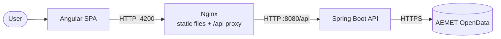
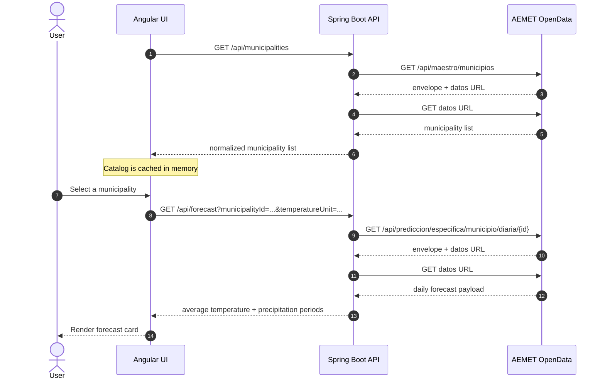
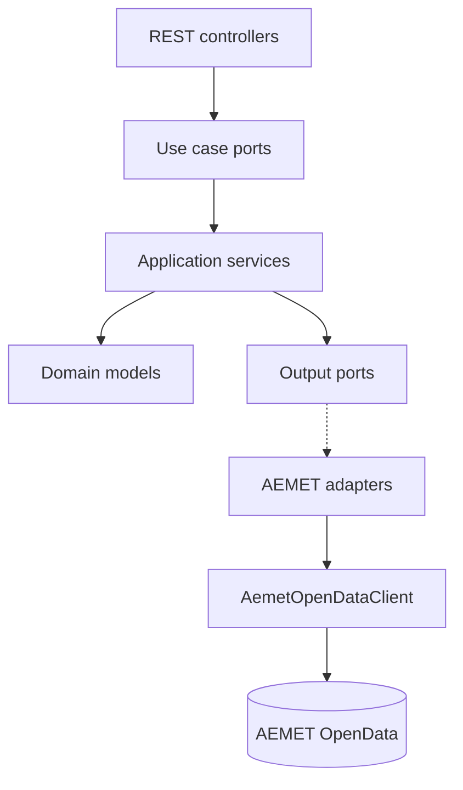

# Architecture

Technical Weather App is a small full-stack system built around a Spring Boot API and an Angular
SPA. The backend integrates with AEMET OpenData, normalizes the external payloads and exposes a
stable API. The frontend loads the municipality catalog once and filters it locally.

## System context



In local development, the Angular dev server replaces the frontend container and uses
`proxy.conf.json` to forward `/api` calls to `http://localhost:8080`.

The published demo uses a single container instead: Spring Boot serves the Angular build from its
static resources and exposes the API on the same origin. See
[DEMO_DEPLOYMENT.md](DEMO_DEPLOYMENT.md).

## Request flow



If the catalog is still loading or fails, the autocomplete falls back to remote searches through
`GET /api/municipalities?name=...`. The backend caches the catalog for 24 hours and each forecast
for 30 minutes, so AEMET is only called on a cache miss.

## Backend

The backend uses a lightweight hexagonal structure. The domain and application layers do not depend
on Spring or AEMET; infrastructure adapters implement the domain ports.



- **Inbound adapter**: `MunicipalityController` and `ForecastController` validate HTTP input and
  map results to response DTOs.
- **Application**: `SearchMunicipalitiesService` and `GetMunicipalityForecastService` implement the
  use cases.
- **Domain**: municipality, forecast, temperature unit and precipitation models plus the provider
  ports.
- **Outbound adapter**: AEMET clients, adapters and DTOs.
- **Shared API**: `ApiExceptionHandler` returns `ProblemDetail` responses with a stable `code`.

### Forecast calculation

1. Validate and normalize the municipality ID to a five-digit INE code.
2. Request the daily forecast from AEMET.
3. Select the day after today in `Europe/Madrid`.
4. Calculate the average from available `temperatura.dato` values, falling back to
   `(maxima + minima) / 2`.
5. Convert the Celsius average to the requested unit and keep the `00-06`, `06-12`, `12-18` and
   `18-24` precipitation periods.

### AEMET integration

The backend calls `GET /api/maestro/municipios` and
`GET /api/prediccion/especifica/municipio/diaria/{id}`. AEMET responds in two steps: an envelope
with a `datos` URL, followed by the JSON payload. Before the second request, the client validates
that the URL host is `opendata.aemet.es` or a subdomain.

The API key is read from `AEMET_API_KEY` and never exposed to the frontend.

### Caching

The two outbound AEMET clients use Spring Cache with Caffeine:

- `AemetMunicipalityClient.fetchMunicipalities()` is cached for 24 hours.
- `AemetForecastClient.fetchForecast(municipalityId)` is cached for 30 minutes per municipality.

Cache hits skip both the AEMET envelope and data requests. Empty responses and errors are not
cached. The forecast cache stores AEMET data, so Celsius and Fahrenheit requests share the same
entry.

### Rate limiting and AEMET budget

`RateLimitFilter` protects the public API and the OpenAPI document with in-memory token buckets:

- Per-IP and global limits for `/api/**`.
- Per-IP and global limits for `/v3/api-docs`.
- `429 Too Many Requests` with a `Retry-After` header when a limit is exceeded.
- Swagger UI static assets, `/v3/api-docs/swagger-config`, `/api/health` and static frontend assets
  are excluded.

`AemetCallBudget` limits outbound AEMET calls:

- Per-minute token bucket and daily counter.
- The daily counter resets at midnight in `Europe/Madrid`.
- Exhausted budgets return `503` with code `BUDGET_EXHAUSTED`.

Both mechanisms are held in memory and assume a single backend replica. Scaling horizontally
would require a shared store such as Redis.

## Frontend

The Angular application uses standalone components, Angular Router and PrimeNG Aura. The weather
feature is organized as a vertical slice:

```text
frontend/src/app/features/weather/
├── components/      # autocomplete, unit selector and forecast card
├── models/          # municipality, forecast and unit models
├── pages/           # weather page composition
├── services/        # API service, municipality search store and forecast store
└── utils/           # name normalization and error mapping
```

The autocomplete loads the catalog once, filters locally after three characters and falls back to
the backend while the catalog is loading. The forecast store selects tomorrow's data, reacts to
unit changes and clears the result when the municipality is cleared.

## Limitations

- No authentication, database or persistence.
- The cache, rate limits and AEMET budget use in-memory state and assume a single replica.
- Tomorrow's forecast only.
- No retries or circuit breaker for AEMET.
- The municipality endpoint returns the full catalog when no name is provided.

The planned work is tracked in [IMPROVEMENTS.md](IMPROVEMENTS.md).

## Related documentation

- [Onboarding guide](ONBOARDING.md)
- [Demo deployment guide](DEMO_DEPLOYMENT.md)
- [Questions and answers](QUESTIONS.md)
- [Root README](../README.md)
